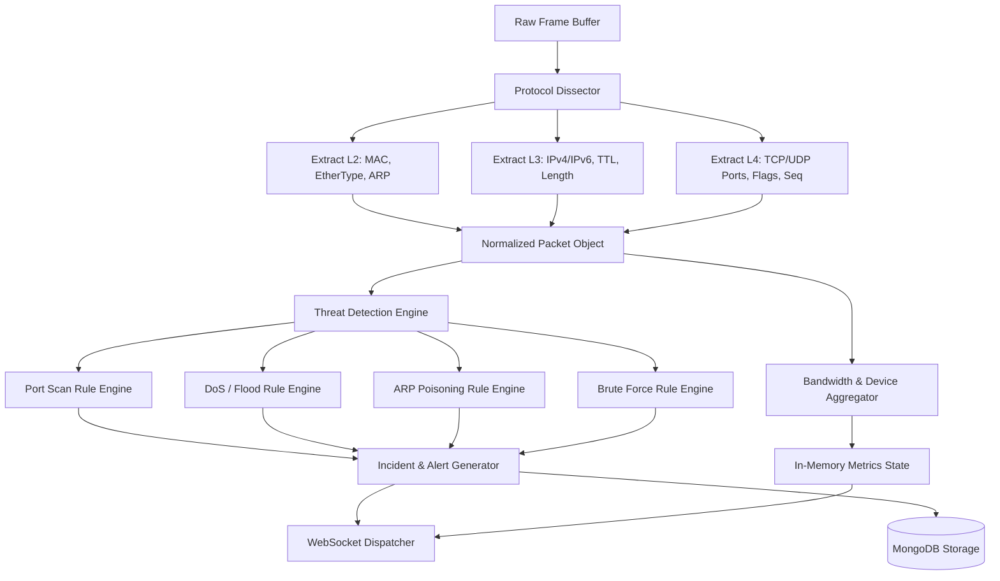
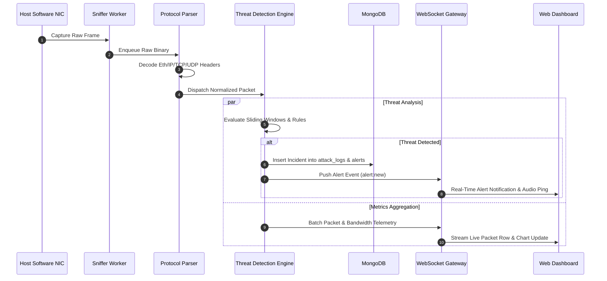

# System Architecture Document
## Real-Time Network Monitoring and Threat Detection System

---

### Architecture Overview
The **Real-Time Network Monitoring and Threat Detection System** is engineered as a high-performance, asynchronous, multi-layered software architecture. Designed as a **100% pure software solution**, it operates entirely on the host operating system's software network stack (via `libpcap`/`Npcap` raw socket drivers) without requiring external hardware probes, physical taps, or embedded devices.

The system decouples packet capture and detection from web serving by employing a multi-threaded/asynchronous worker model, message queues, and a real-time WebSocket distribution channel connected to an interactive Single-Page Application (SPA) dashboard.

---

## 1. High-Level Multi-Tier System Architecture

```
┌────────────────────────────────────────────────────────────────────────────────────────┐
│                               PRESENTATION LAYER (Frontend)                            │
│                                                                                        │
│  ┌──────────────────────────────────────────────────────────────────────────────────┐  │
│  │                     Single Page Application (React / Modern Web UI)              │  │
│  │  ┌─────────────────┐  ┌──────────────────┐  ┌─────────────────┐  ┌─────────────┐ │  │
│  │  │ Live Dashboard  │  │ Traffic Visuals  │  │  Alerts Feed    │  │ Forensic Log│ │  │
│  │  │ (Stats/Badges)  │  │ (Charts/Graphs)  │  │  (Real-Time Pop)│  │ (Query Grid)│ │  │
│  │  └────────▲────────┘  └────────▲─────────┘  └────────▲────────┘  └──────▲──────┘ │  │
│  └───────────┼────────────────────┼─────────────────────┼──────────────────┼────────┘  │
└──────────────┼────────────────────┼─────────────────────┼──────────────────┼───────────┘
               │                    │                     │                  │
        (WebSocket / WSS)    (WebSocket / WSS)     (WebSocket / WSS)   (HTTP REST API)
               │                    │                     │                  │
┌──────────────▼────────────────────▼─────────────────────▼──────────────────▼───────────┐
│                           API & REAL-TIME GATEWAY LAYER                                │
│                                                                                        │
│  ┌──────────────────────────────────────────────┐  ┌────────────────────────────────┐  │
│  │           WebSocket Server (Socket.io)       │  │        REST API Controller     │  │
│  │  - Live Packet Streamer (100ms batched)      │  │  - Auth & JWT Middleware       │  │
│  │  - Real-Time Alert Broadcaster               │  │  - Historical Data Filtering   │  │
│  │  - Active Device State Synchronizer          │  │  - System Config & Thresholds  │  │
│  └──────────────────────▲───────────────────────┘  └───────────────▲────────────────┘  │
└─────────────────────────┼──────────────────────────────────────────┼───────────────────┘
                          │ (Event Bus / Inter-Process Callbacks)    │
┌─────────────────────────┴──────────────────────────────────────────┴───────────────────┐
│                         CORE PROCESSING & DETECTION LAYER                              │
│                                                                                        │
│  ┌─────────────────────────┐  ┌─────────────────────────┐  ┌────────────────────────┐  │
│  │  Bandwidth Aggregator   │  │ Threat Detection Engine │  │ Host Inventory Manager │  │
│  │  - Rolling Bps / pps    │  │  - Port Scan Heuristic  │  │  - MAC/IP Endpoint Map │  │
│  │  - Protocol Split %     │  │  - SYN Flood / DoS Rule │  │  - Ingress/Egress Stat │  │
│  │  - Peak Spikes Detector │  │  - ARP Poisoning Rule   │  │  - Host Active State   │  │
│  │                         │  │  - Brute Force Detector │  │                        │  │
│  └────────────▲────────────┘  └───────────▲─────────────┘  └───────────▲────────────┘  │
│               │                           │                            │               │
│               └───────────────────────────┼────────────────────────────┘               │
│                                           │ (Parsed Packet Object)                     │
│                                ┌──────────┴──────────┐                                 │
│                                │  Protocol Dissector │                                 │
│                                │  & Metadata Parser  │                                 │
│                                └──────────▲──────────┘                                 │
│                                           │ (Raw Packet Byte Stream)                   │
│                                ┌──────────┴──────────┐                                 │
│                                │  Ring Buffer Queue  │                                 │
│                                └──────────▲──────────┘                                 │
└───────────────────────────────────────────┼────────────────────────────────────────────┘
                                            │
┌───────────────────────────────────────────┴────────────────────────────────────────────┐
│                    NETWORK CAPTURE LAYER (Software Kernel Drivers)                     │
│                                                                                        │
│  ┌──────────────────────────────────────────────────────────────────────────────────┐  │
│  │                     Packet Sniffing Worker (Python Scapy / Libpcap)              │  │
│  │  - Asynchronous Raw Socket Listener                                              │  │
│  │  - Promiscuous Mode Interception on Host Virtual / Physical NIC                  │  │
│  │  - Configurable BPF Packet Filter                                                │  │
│  └────────────────────────────────────────▲─────────────────────────────────────────┘  │
└───────────────────────────────────────────┼────────────────────────────────────────────┘
                                            │
               ┌────────────────────────────┴────────────────────────────┐
               │  Host OS Software Network Stack (Windows Npcap / Linux) │
               │  [ Wi-Fi / Ethernet / Local Virtual Loopback Adapters ] │
               └─────────────────────────────────────────────────────────┘
```

---

## 2. Component Deconstruction

### 2.1 Network Capture Layer
- **Responsibility**: Passively captures raw ethernet frames from the operating system's software network interface without interfering with existing TCP/IP stack operations.
- **Key Modules**:
  - `InterfaceScanner`: Queries OS network adapters (via `scapy.interfaces` or `netifaces`) and returns adapter names, IP addresses, MAC addresses, and operational status.
  - `AsyncSnifferWorker`: Executes an unbuffered promiscuous capture thread using raw sockets / Npcap. Packages raw binary frames into timestamped lightweight payload wrappers and enqueues them into an in-memory ring buffer.
- **Zero-Hardware Reliance**: Uses solely the host machine's software network drivers.

### 2.2 Core Processing & Detection Layer



- **Protocol Dissector**: Converts raw packet binary streams into structured JSON/Python dictionaries containing standard protocol fields.
- **Stateful Sliding Windows**: Maintains high-speed in-memory hash maps (`collections.deque` / Redis-like TTL dicts) keyed by Source IP to record recent activity across rolling time windows ($T = 5\text{s}$ to $60\text{s}$).
- **Threat Detection Engine**:
  - *Heuristic Evaluator*: Compares sliding window metrics against baseline thresholds.
  - *Signature Evaluator*: Matches illegal or anomalous packet flag combinations (e.g. TCP NULL, XMAS, unusual TCP flags).
  - *Mitigation Adviser*: Attaches actionable security recommendations (e.g., "Block IP via iptables/Windows Firewall", "Isolate MAC address") to generated alerts.

### 2.3 Persistence Layer (MongoDB)
The persistence layer utilizes MongoDB for flexible, high-speed document storage:
- **`packet_logs`**: Stores raw packet telemetry with a **Time-To-Live (TTL) index** (e.g., auto-expiring documents after 24 hours to prevent disk saturation).
- **`bandwidth_metrics`**: Stores 1-minute rollup summaries for long-term trend analysis.
- **`alerts`**: Stores generated security alerts with severity ratings, timestamps, and resolution states (`NEW`, `ACKNOWLEDGED`, `RESOLVED`).
- **`attack_logs`**: Stores forensic evidence packets, attacker metadata, and affected target ports for incident investigation.
- **`devices`**: Maintains known host records (IP, MAC, Hostname, Total Transferred Bytes).

### 2.4 API & Real-Time Gateway Layer
- **RESTful Endpoints**: Built with FastAPI / Express to handle CRUD operations on logs, authentication, threshold updates, and report exports.
- **WebSocket Gateway**: Utilizes `Socket.io` / native WebSockets to broadcast telemetry events:
  - `packet:stream`: Emits throttled arrays of packet objects (every 100ms).
  - `metrics:update`: Emits rolling 1-second bandwidth throughput and protocol splits.
  - `alert:new`: Instantly emits high-priority security notifications when threat detection rules trigger.
  - `device:update`: Emits updates when new devices appear or change bandwidth usage.

### 2.5 Presentation Layer (Web Dashboard)
- Built as a responsive modern web dashboard using React/Tailwind CSS with glassmorphism visual styling and dark mode.
- Renders live dynamic charts (Chart.js / Recharts) with smooth sub-second line transitions.
- Interactive packet grid with multi-column filtering, pause/play capture controls, and packet header modal viewer.

---

## 3. Data Flow Architecture & Pipeline



---

## 4. Concurrency and Threading Architecture

To maintain high throughput and guarantee zero UI lag:
1. **Thread 1 (Capture Worker)**: Dedicated thread running libpcap packet loop. It does no heavy computation—only places raw packets into a bounded thread-safe Queue (`queue.Queue(maxsize=10000)`).
2. **Thread 2 (Parser & Detection Worker)**: Consumes from the queue, performs protocol decoding, updates sliding window maps, and evaluates threat rules.
3. **Async Event Loop (API & WebSocket Server)**: Handles client HTTP requests and manages connected WebSocket sockets, receiving broadcast batches via async inter-thread queues without blocking.

---

## 5. Software-Only Deployment Architecture

The entire system is deployed on standard PC/server hardware running standard operating systems:

```
┌─────────────────────────────────────────────────────────────┐
│                      Host Machine (PC / Laptop / VM)        │
│                                                             │
│  ┌───────────────────────────────────────────────────────┐  │
│  │                   Web Browser Client                  │  │
│  │               http://localhost:3000 / 5173            │  │
│  └───────────────────────────▲───────────────────────────┘  │
│                              │ (HTTP / WebSocket)           │
│  ┌───────────────────────────▼───────────────────────────┐  │
│  │            Backend Server (Port 5000 / 8000)          │  │
│  │  - Python FastAPI / Node.js Engine                    │  │
│  │  - Scapy / Npcap Capture Subsystem                    │  │
│  └───────────────────────────▲───────────────────────────┘  │
│                              │ (MongoDB Wire Protocol 27017)│
│  ┌───────────────────────────▼───────────────────────────┐  │
│  │            Local MongoDB Database Service             │  │
│  └───────────────────────────────────────────────────────┘  │
│                                                             │
│  ┌───────────────────────────────────────────────────────┐  │
│  │       Host OS Software Network Adapter (Physical/Wi-Fi)│ │
│  └───────────────────────────────────────────────────────┘  │
└─────────────────────────────────────────────────────────────┘
```

---

## 6. Architectural Quality Attributes

| Attribute | Architectural Strategy |
| :--- | :--- |
| **Low Latency** | Asynchronous packet parsing and batched WebSocket emissions (< 500ms end-to-end). |
| **Fault Isolation** | Packet capture thread runs independently; if capture encounters an invalid frame, it is dropped without crashing the web server. |
| **Storage Optimization** | TTL expiration indexes automatically prune raw packet traces after 24h, keeping disk usage bounded. |
| **Zero Hardware Overhead** | Utilizes standard OS socket interfaces; easily portable across laptops, desktops, and virtual machines. |
