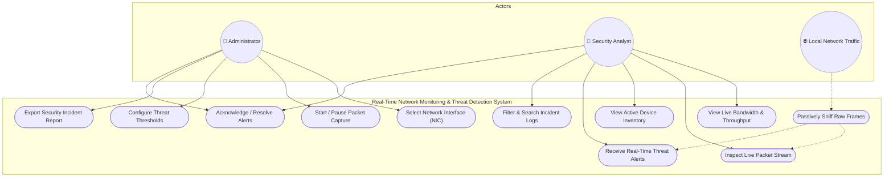
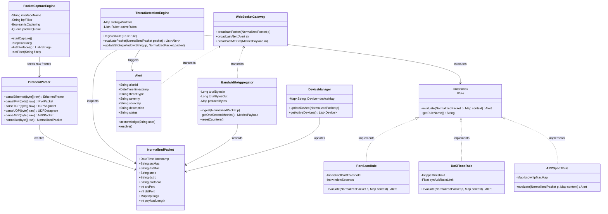
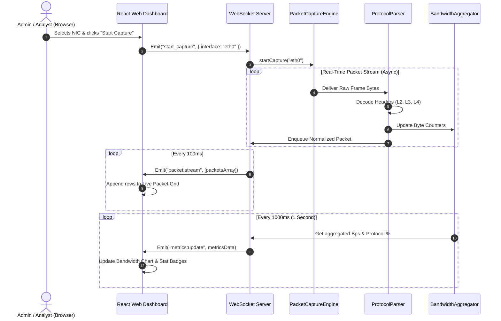
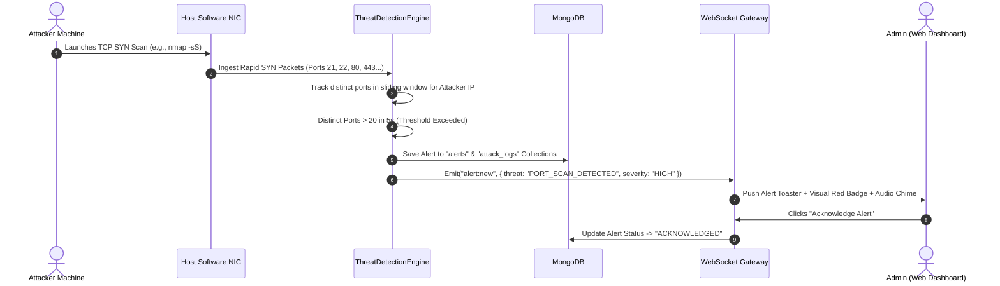
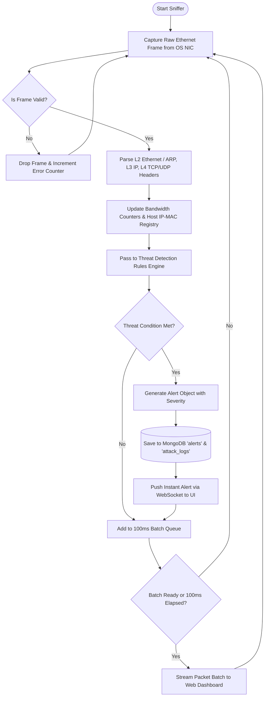
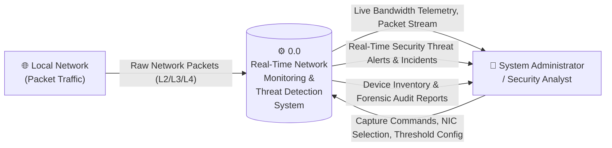
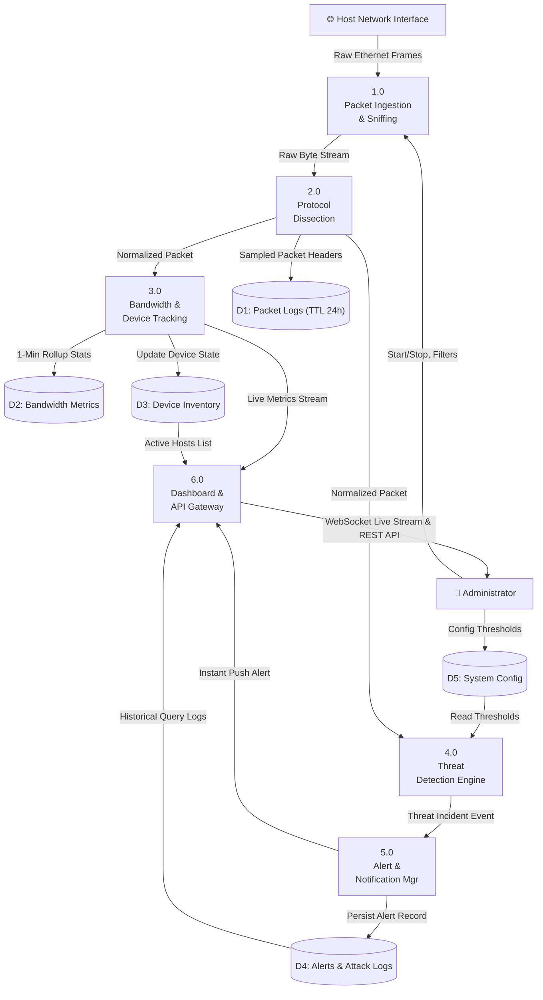
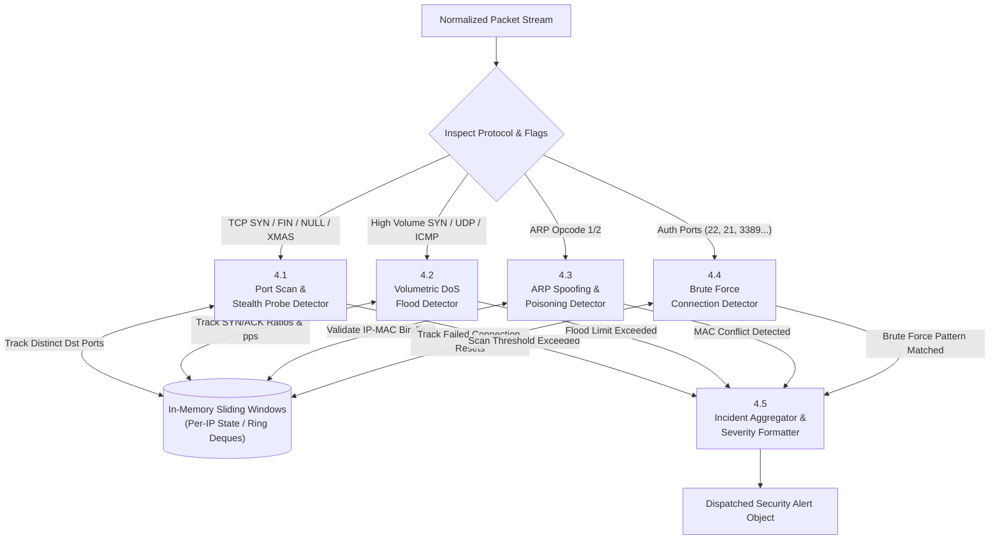
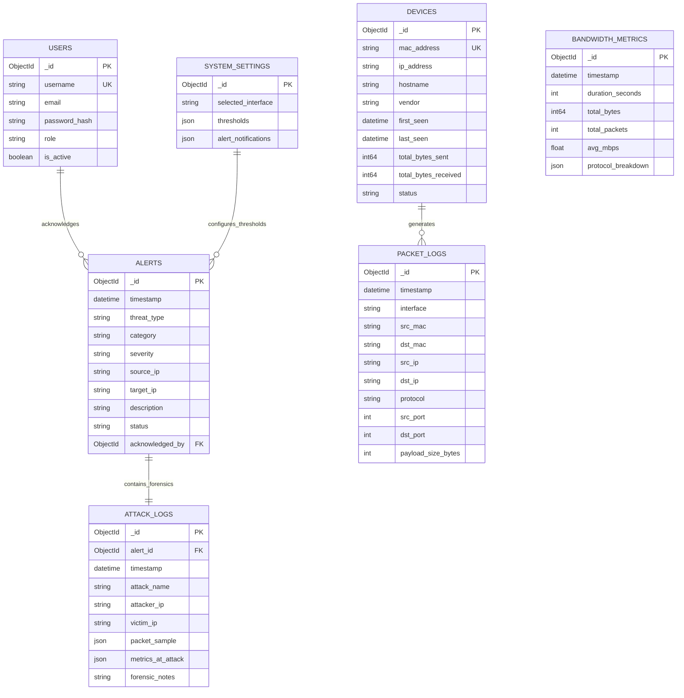

# UML & Data Flow Diagrams (DFD) Specifications
## Real-Time Network Monitoring and Threat Detection System

---

### Overview
This document delivers the formal object-oriented and structured system analysis diagrams for the **Real-Time Network Monitoring and Threat Detection System**. All diagrams are authored using standard **Mermaid.js** syntax for integration into documentation viewers, academic reports, and IDEs.

---

## 1. Use Case Diagram

The Use Case Diagram defines the interactions between human actors (System Administrator, Security Analyst), external network traffic, and system components.

---

## 2. Class Diagram (Object-Oriented Design)

Represents the core software classes, their attributes, methods, and relationships.

---

## 3. Sequence Diagrams

### 3.1 Live Packet Capture & Real-Time Streaming Sequence

---

### 3.2 Threat Detection & Security Alert Sequence

---

## 4. Activity Diagram: Packet Processing Lifecycle

---

## 5. Data Flow Diagrams (DFD)

### 5.1 DFD Level 0 (Context Diagram)

The Context Diagram defines the system boundary, external entities, and high-level data streams.

---

### 5.2 DFD Level 1 (Subsystem Deconstruction)

Deconstructs the system into its primary functional processes and data stores.

---

### 5.3 DFD Level 2 (Threat Detection & Analysis Subsystem)

Deep dive into Process 4.0 (Threat Detection Engine).

---

## 6. Entity-Relationship (ER) Diagram

Represents the data entities, attributes, and relationships stored in MongoDB.

