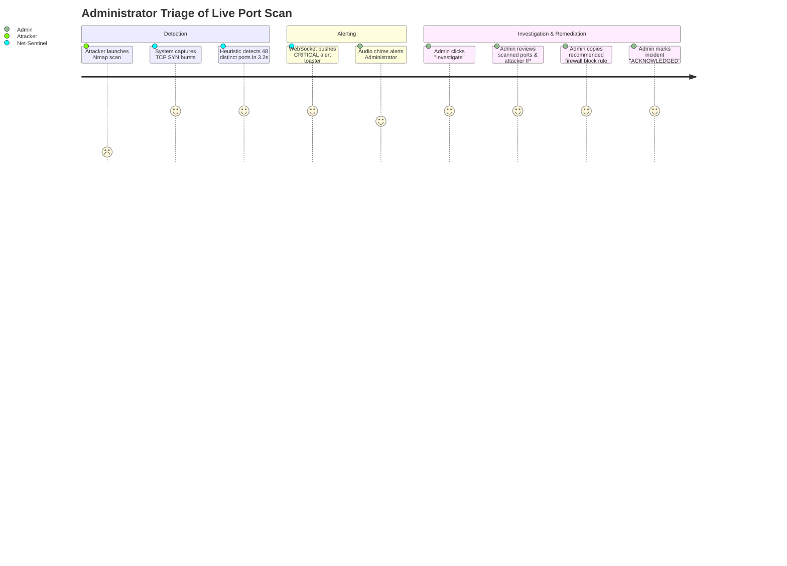

# Product Requirements Document (PRD)
## Real-Time Network Monitoring and Threat Detection System
*(Web-Based Network Monitoring and Network Attack Analyzer)*

---

### Document Control
- **Document Type**: Product Requirements Document (PRD)
- **Product Name**: Real-Time Network Monitoring and Threat Detection System (Net-Sentinel)
- **Version**: 1.0.0
- **Product Category**: Pure Software Cybersecurity & Network Observability Platform
- **Document Owner**: Lead Product Architect & System Engineering Team

---

## 1. Executive Summary & Market Problem

### 1.1 Problem Statement
Modern enterprise, institutional, and campus local area networks face increasing cybersecurity threats—such as stealth port reconnaissance, distributed volumetric DoS floods, ARP cache poisoning (MITM), and brute-force credential attacks. 

However, existing network monitoring solutions suffer from three fundamental problems:
1. **Hardware & Appliance Dependency**: Enterprise intrusion detection systems (IDS/IPS) require costly hardware taps, SPAN ports, or dedicated appliance servers.
2. **Complexity & Steep Learning Curves**: Tools like Wireshark or raw command-line tcpdump are offline packet decoders that require specialized expertise and lack automated threat evaluation or real-time web alerts.
3. **Siloed Monitoring**: Traditional tools separate general bandwidth traffic monitoring from security incident detection, forcing administrators to juggle multiple disjointed tools.

### 1.2 Proposed Product Solution
The **Real-Time Network Monitoring and Threat Detection System** is an all-in-one, 100% software-based platform that combines passive packet inspection, dynamic bandwidth telemetry, connected device tracking, and automated real-time threat detection into a single, intuitive web-based interface.

```
┌────────────────────────────────────────────────────────────────────────┐
│                        CORE VALUE PROPOSITIONS                         │
├───────────────────┬───────────────────┬────────────────────────────────┤
│ 100% Pure Software│ Sub-Second Threat │ All-in-One Operations          │
│ Runs on standard  │ Instant detection │ Bandwidth charts, live packets,│
│ PC/laptop software│ & WebSocket push  │ device tracking, & threat hub  │
│ network interfaces│ within < 500ms    │ in one unified web dashboard   │
└───────────────────┴───────────────────┴────────────────────────────────┘
```

---

## 2. Target User Personas & User Journeys

### 2.1 User Personas

| Persona Attribute | Persona 1: Alex (Network Administrator) | Persona 2: Sarah (Security Analyst) | Persona 3: Sujoy (Student / Evaluator) |
| :--- | :--- | :--- | :--- |
| **Role** | Campus / Enterprise Network Admin | Cybersecurity Incident Responder | Computer Science Engineering Student |
| **Primary Goal** | Ensure high network uptime & monitor bandwidth usage. | Rapidly identify, investigate, and mitigate malicious attacks. | Demonstrate a working, high-impact final year project. |
| **Key Pain Point** | Hard to identify which host is choking bandwidth or scanning the LAN. | Too many manual CLI logs; delayed threat discovery. | Complex setups that require specialized hardware or fail in demos. |
| **Tech Level** | High (Networking & Infrastructure) | High (Security & Forensics) | Moderate to High (Full-Stack Dev) |

---

### 2.2 End-to-End User Journeys

#### Journey 1: Identifying & Mitigating a Live Port Scan Attack


---

## 3. Product Feature Epics & Acceptance Criteria

### Epic 1: Passive Packet Ingestion & Capture Control
- **Description**: As an administrator, I want to select my active software network interface and initiate packet sniffing so that all traffic traversing my interface is captured in real time.
- **Acceptance Criteria (Gherkin Format)**:
  - **Scenario 1.1: Interface Discovery**:
    - *Given* the backend server is running with appropriate OS privileges,
    - *When* the user accesses the interface settings dropdown,
    - *Then* all physical (Ethernet, Wi-Fi) and virtual software adapters are listed with their corresponding IP and MAC addresses.
  - **Scenario 1.2: Capture Activation**:
    - *Given* a valid network interface is selected,
    - *When* the user clicks "Start Capture",
    - *Then* the capture status transitions to "ACTIVE", the live visual indicator pulses green, and raw frames begin streaming into the pipeline.

---

### Epic 2: Real-Time Protocol Decoding & Normalization
- **Description**: As a security analyst, I want raw frames decoded across Layers 2, 3, 4, and 7 so that I can inspect IP addresses, port numbers, protocol flags, and payload lengths.
- **Acceptance Criteria**:
  - **Scenario 2.1: Multi-Layer Extraction**:
    - *Given* an incoming raw frame buffer,
    - *When* the protocol dissector executes,
    - *Then* it extracts Ethernet MACs, IPv4/v6 addresses, TTL, TCP/UDP ports, TCP flags (`SYN`, `ACK`, `FIN`, `RST`, `PSH`, `URG`), and ICMP types into a normalized JSON schema.

---

### Epic 3: Multi-Vector Threat & Anomaly Detection
- **Description**: As a security analyst, I want the system to automatically analyze packet patterns to detect port scans, DoS floods, ARP spoofing, and brute-force attempts.
- **Acceptance Criteria**:
  - **Scenario 3.1: TCP Port Scan Detection**:
    - *Given* an active capture session,
    - *When* a single source IP probes $> 20$ distinct destination ports within 5 seconds,
    - *Then* a `PORT_SCAN_DETECTED` alert is generated with severity `HIGH`, containing the list of target ports.
  - **Scenario 3.2: SYN Flood DoS Detection**:
    - *Given* an active capture session,
    - *When* a source IP emits $> 100 \text{ SYN pps}$ with a SYN-to-ACK ratio $> 10:1$,
    - *Then* a `SYN_FLOOD_DOS` alert is triggered with severity `CRITICAL`.
  - **Scenario 3.3: ARP Cache Poisoning Detection**:
    - *Given* an authoritative table of known IP-MAC pairings,
    - *When* an incoming ARP reply attempts to map an existing IP to a different MAC address,
    - *Then* an `ARP_SPOOFING_ATTACK` alert is triggered immediately with severity `CRITICAL`.

---

### Epic 4: Real-Time Telemetry & WebSocket Streaming
- **Description**: As a user, I want live throughput graphs and packet stream tables updated with sub-second latency without needing to refresh the browser.
- **Acceptance Criteria**:
  - **Scenario 4.1: Live Bandwidth Rollup**:
    - *Given* an active client connection,
    - *When* traffic flows through the sniffer,
    - *Then* the dashboard receives a `metrics:update` WebSocket event every 1,000ms updating the Ingress/Egress Mbps graph and protocol percentage breakdown.
  - **Scenario 4.2: Throttled Packet Streaming**:
    - *Given* high-volume traffic (e.g. 5,000 pps),
    - *When* streaming to the web UI,
    - *Then* packets are emitted in 100ms batched arrays to maintain a smooth 60 FPS UI rendering experience.

---

### Epic 5: Incident Management, Forensics & Export
- **Description**: As an auditor, I want to search historical attack incidents, review packet forensic details, and export CSV/JSON reports.
- **Acceptance Criteria**:
  - **Scenario 5.1: Forensic Filtering**:
    - *Given* historical alerts stored in MongoDB,
    - *When* the user filters by date range, severity `CRITICAL`, or source IP,
    - *Then* the matching incident records are returned in $< 100\text{ms}$.
  - **Scenario 5.2: Report Export**:
    - *Given* a filtered set of incident records,
    - *When* the user clicks "Export CSV",
    - *Then* a structured `.csv` file containing incident timestamps, IPs, attack classifications, and forensic notes downloads immediately.

---

## 4. Key Performance Indicators (KPIs) & Success Metrics

| Metric Category | Target KPI Benchmark | Measurement Method |
| :--- | :--- | :--- |
| **Detection Latency** | $\le 500\text{ ms}$ from packet arrival to alert pop | End-to-end WebSocket timestamp delta |
| **Packet Throughput** | $\ge 10,000\text{ packets/sec}$ sustained | Load generator bench without packet drops |
| **False Positive Rate** | $< 1.0\%$ on trusted whitelist traffic | Continuous baseline test with normal browsing |
| **System Memory Footprint**| $< 512\text{ MB}$ backend RAM usage | OS process memory monitor over 4 hours |
| **UI Responsiveness** | Consistent $60\text{ FPS}$ with zero freeze | Chrome DevTools Performance Profiler |
| **Database Query Speed** | $< 50\text{ ms}$ for 100k indexed incident records | MongoDB explain query analysis |

---

## 5. Release Roadmap

```
┌────────────────────────────────────────────────────────────────────────┐
│                        PRODUCT RELEASE ROADMAP                         │
├───────────────────┬───────────────────┬────────────────────────────────┤
│ Phase 1: MVP      │ Phase 2: V1.0     │ Phase 3: Future Vision (V2.0)  │
│ (Weeks 1–2)       │ (Weeks 3–4)       │ (Post-Graduation)              │
├───────────────────┼───────────────────┼────────────────────────────────┤
│ • Promiscuous raw │ • Full 5 Threat   │ • Machine Learning anomaly     │
│   socket sniffer  │   Detection Rules │   detection (Isolation Forest) │
│ • L2-L4 Parser    │ • Real-time React │ • Automated Active Response    │
│ • Basic bandwidth │   Dark Dashboard  │   (Firewall rule push / IPS)   │
│   calculation     │ • WebSocket feeds │ • Distributed multi-agent      │
│ • MongoDB logging │ • Forensic export │   remote subnet monitoring     │
└───────────────────┴───────────────────┴────────────────────────────────┘
```
